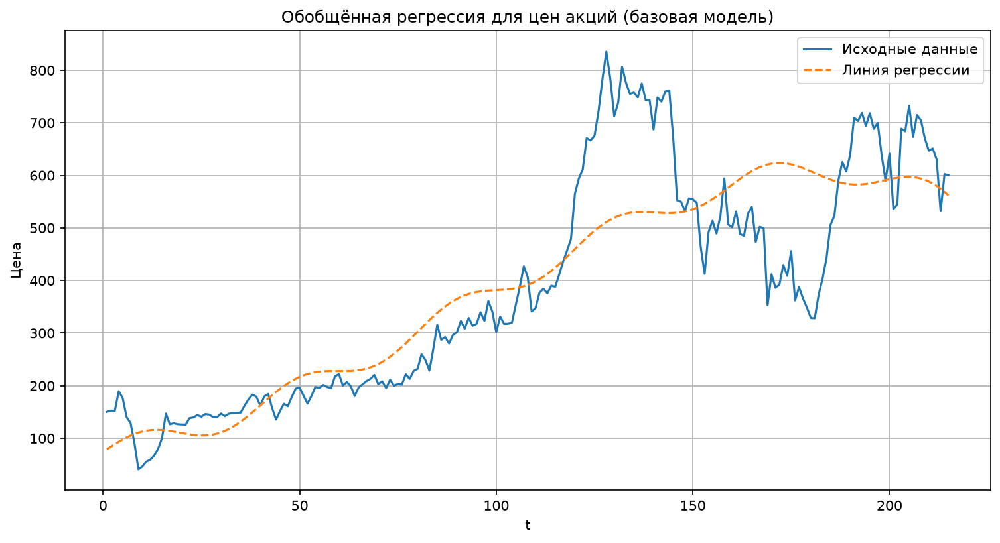
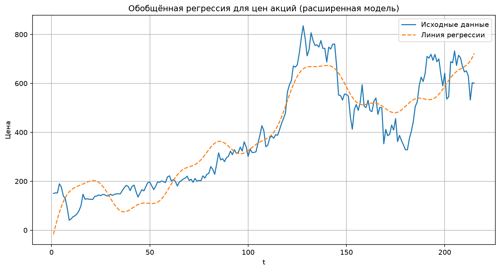
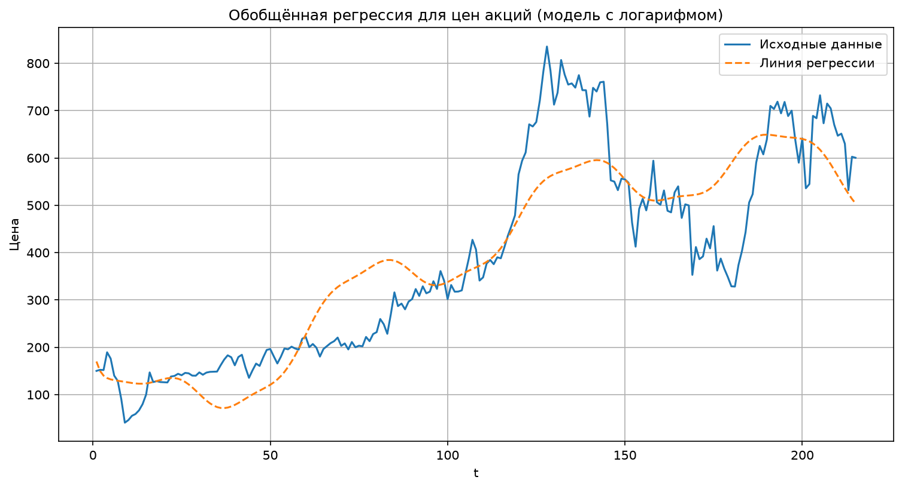

# Обобщённая линейная регрессия для анализа временных рядов

Проект реализует **обобщённую линейную регрессию** для моделирования временного ряда котировок акций компании Татнефть (`TATN`). Вместо одной прямой линии строится линейная комбинация выбранных базисных функций (полиномы, синусоиды, экспонента, логарифм), коэффициенты находятся методом наименьших квадратов.

Сравниваются три варианта модели с разными наборами базисных функций, качество оценивается по RMSE.

## Возможности

- загрузка исторических котировок из Excel (`TATN.xlsx`);
- построение обобщённой регрессии на произвольном наборе базисных функций;
- аналитическое решение системы нормальных уравнений через `numpy.linalg.solve`;
- визуализация исходного ряда и модельной кривой;
- сравнение моделей по среднеквадратичной ошибке (RMSE).

## Теория

### Обобщённая линейная регрессия

Обобщённая линейная регрессия - статистическая модель, которая описывает зависимость зависимой переменной $y$ от независимой переменной $t$ через линейную комбинацию произвольных базисных функций $f_k(t)$. Сами функции могут быть нелинейными (полиномы, синусоиды, экспоненты), но относительно коэффициентов модель остаётся линейной.

Модельное значение в точке $t_i$:

$$
m_i = \sum_k C_k \cdot f_k(t_i)
$$

где:

- $m_i$ - модельное значение;
- $C_k$ - неизвестные коэффициенты;
- $f_k(t_i)$ - базисные функции в момент времени $t_i$ (константа, линейная, квадратичная, синусоидальная, экспоненциальная и др.).

### Метод наименьших квадратов

Метод наименьших квадратов (МНК) ищет такие коэффициенты $C_k$, при которых сумма квадратов отклонений реальных значений $y_i$ от модельных $m_i$ минимальна.

Целевая функция ошибки:

$$
E(\mathbf{C}) = \sum_i \left( \sum_k C_k \cdot f_k(t_i) - y_i \right)^2 \to \min
$$

где:

- $\mathbf{C} = (C_1, C_2, \ldots)$ - вектор коэффициентов;
- $f_k(t_i)$ - значения базисных функций в момент $t_i$;
- $y_i$ - реальные значения зависимой переменной.

Минимум достигается в точке, где градиент равен нулю. Для каждого коэффициента $C_k$ условие экстремума:

$$
\frac{\partial E}{\partial C_k} = 2 \sum_{i=1}^{N} \left( \sum_j C_j \cdot f_j(t_i) - y_i \right) f_k(t_i) = 0
$$

### Вывод для пяти базисных функций

Для наглядности рассмотрим модель из пяти компонент:

$$
m_i = A \cdot f_i + B \cdot g_i + C \cdot h_i + D \cdot p_i + E \cdot q_i
$$

Функция ошибки:

$$
E(A, B, C, D, E) = \sum_i \left( A \cdot f_i + B \cdot g_i + C \cdot h_i + D \cdot p_i + E \cdot q_i - y_i \right)^2
$$

Приравниваем частные производные к нулю:

$$
\frac{\partial E}{\partial A} = 2 \sum_i \left( A f_i + B g_i + C h_i + D p_i + E q_i - y_i \right) f_i = 0
$$

$$
\frac{\partial E}{\partial B} = 2 \sum_i \left( A f_i + B g_i + C h_i + D p_i + E q_i - y_i \right) g_i = 0
$$

$$
\frac{\partial E}{\partial C} = 2 \sum_i \left( A f_i + B g_i + C h_i + D p_i + E q_i - y_i \right) h_i = 0
$$

$$
\frac{\partial E}{\partial D} = 2 \sum_i \left( A f_i + B g_i + C h_i + D p_i + E q_i - y_i \right) p_i = 0
$$

$$
\frac{\partial E}{\partial E} = 2 \sum_i \left( A f_i + B g_i + C h_i + D p_i + E q_i - y_i \right) q_i = 0
$$

Введём средние значения:

$$
\langle k_i \rangle = \frac{1}{N} \sum_{i=1}^{N} k_i
$$

Тогда нормальные уравнения принимают вид:

$$
\begin{aligned}
A\langle f_i f_i \rangle + B\langle f_i g_i \rangle + C\langle f_i h_i \rangle + D\langle f_i p_i \rangle + E\langle f_i q_i \rangle &= \langle f_i y_i \rangle \\
A\langle g_i f_i \rangle + B\langle g_i g_i \rangle + C\langle g_i h_i \rangle + D\langle g_i p_i \rangle + E\langle g_i q_i \rangle &= \langle g_i y_i \rangle \\
A\langle h_i f_i \rangle + B\langle h_i g_i \rangle + C\langle h_i h_i \rangle + D\langle h_i p_i \rangle + E\langle h_i q_i \rangle &= \langle h_i y_i \rangle \\
A\langle p_i f_i \rangle + B\langle p_i g_i \rangle + C\langle p_i h_i \rangle + D\langle p_i p_i \rangle + E\langle p_i q_i \rangle &= \langle p_i y_i \rangle \\
A\langle q_i f_i \rangle + B\langle q_i g_i \rangle + C\langle q_i h_i \rangle + D\langle q_i p_i \rangle + E\langle q_i q_i \rangle &= \langle q_i y_i \rangle
\end{aligned}
$$

В матричной форме:

$$
M \begin{pmatrix} A \\ B \\ C \\ D \\ E \end{pmatrix}
=
\begin{pmatrix}
\langle f_i y_i \rangle \\
\langle g_i y_i \rangle \\
\langle h_i y_i \rangle \\
\langle p_i y_i \rangle \\
\langle q_i y_i \rangle
\end{pmatrix}
$$

где симметричная матрица средних произведений базисных функций:

$$
M =
\begin{pmatrix}
\langle f_i f_i \rangle & \langle f_i g_i \rangle & \langle f_i h_i \rangle & \langle f_i p_i \rangle & \langle f_i q_i \rangle \\
\langle g_i f_i \rangle & \langle g_i g_i \rangle & \langle g_i h_i \rangle & \langle g_i p_i \rangle & \langle g_i q_i \rangle \\
\langle h_i f_i \rangle & \langle h_i g_i \rangle & \langle h_i h_i \rangle & \langle h_i p_i \rangle & \langle h_i q_i \rangle \\
\langle p_i f_i \rangle & \langle p_i g_i \rangle & \langle p_i h_i \rangle & \langle p_i p_i \rangle & \langle p_i q_i \rangle \\
\langle q_i f_i \rangle & \langle q_i g_i \rangle & \langle q_i h_i \rangle & \langle q_i p_i \rangle & \langle q_i q_i \rangle
\end{pmatrix}
$$

Решение через обратную матрицу:

$$
\begin{pmatrix} A \\ B \\ C \\ D \\ E \end{pmatrix}
=
M^{-1}
\begin{pmatrix}
\langle f_i y_i \rangle \\
\langle g_i y_i \rangle \\
\langle h_i y_i \rangle \\
\langle p_i y_i \rangle \\
\langle q_i y_i \rangle
\end{pmatrix}
$$

На практике систему решают численно (`numpy.linalg.solve`), что эквивалентно умножению на $M^{-1}$, но обычно устойчивее.

### Метрика качества

Среднеквадратичная ошибка:

$$
\mathrm{MSE} = \frac{1}{n} \sum_{i=1}^{n} (y_i - m_i)^2
$$

$$
\mathrm{RMSE} = \sqrt{\mathrm{MSE}} = \sqrt{\frac{1}{n} \sum_{i=1}^{n} (y_i - m_i)^2}
$$

Чем меньше RMSE, тем лучше модель описывает исходный ряд.

## Структура проекта

```text
.
├── TATN.xlsx                 # исторические котировки TATN
├── model_basic.py            # базовая модель (5 функций)
├── model_extended.py         # расширенная модель (полиномы + несколько синусоид)
├── model_logarithmic.py      # модель с логарифмической компонентой
├── assets/                   # графики результатов
│   ├── regression_basic.png
│   ├── regression_extended.png
│   └── regression_logarithmic.png
├── requirements.txt
└── README.md
```

## Установка и запуск

```bash
python -m venv .venv
```

Windows:

```bash
.venv\Scripts\activate
```

Linux / macOS:

```bash
source .venv/bin/activate
```

```bash
pip install -r requirements.txt
```

Запуск моделей:

```bash
python model_basic.py
python model_extended.py
python model_logarithmic.py
```

Каждый скрипт выведет коэффициенты и RMSE, покажет график и сохранит его в папку `assets/`.

## Модели и результаты

### 1. Базовая модель (`model_basic.py`)

Базисные функции:

$$
f(x) = 1,\quad
g(x) = x,\quad
h(x) = x^2,\quad
p(x, T) = \sin\left(\frac{2\pi}{T} x\right),\quad
r(x, k) = e^{k x}
$$

Параметры: $T = 40$, $k = 0.01$.

Коэффициенты:

$$
\begin{aligned}
A &= 366.4900 \\
B &= 4.2704 \\
C &= 0.0383 \\
D &= 23.0849 \\
E &= -292.5075
\end{aligned}
$$

**RMSE: 111.30**



Модель улавливает общий рост котировок, но хуже описывает резкие локальные колебания. Коэффициенты умеренные, признаков явного переобучения нет.

### 2. Расширенная модель (`model_extended.py`)

Базисные функции:

$$
\begin{aligned}
f(x) &= 1,\quad
g(x) = x,\quad
h(x) = x^2,\quad
s(x) = x^3,\quad
t(x) = x^4 \\
p(x, \omega) &= \sin(\omega x),\quad
r(x, k) = e^{k x}
\end{aligned}
$$

Используются три синусоиды с периодами $20$, $40$, $60$ и экспонента с $k = 0.005$.

**RMSE: 78.25**



Лучший результат среди трёх вариантов: линия регрессии точнее повторяет и тренд, и локальные колебания. При этом коэффициенты очень большие по модулю - возможны мультиколлинеарность и переобучение из-за высокой гибкости набора функций.

### 3. Модель с логарифмом (`model_logarithmic.py`)

Базисные функции:

$$
\begin{aligned}
f(x) &= 1,\quad
g(x) = x,\quad
h(x) = x^2 \\
p_{\text{short}}(x) &= \sin\left(\frac{2\pi}{20} x\right),\quad
p_{\text{long}}(x) = \sin\left(\frac{2\pi}{60} x\right) \\
r(x) &= e^{0.005 x},\quad
s(x) = \ln(x + 1)
\end{aligned}
$$

**RMSE: 99.20**



Результат лучше базовой модели, но хуже расширенной. Логарифмическая компонента не дала сильного выигрыша - в ряде нет явного эффекта насыщения. Коэффициенты умеренные.

## Сравнение моделей

| Модель | Файл | RMSE | Комментарий |
| --- | --- | ---: | --- |
| Базовая | `model_basic.py` | 111.30 | простая и интерпретируемая |
| Расширенная | `model_extended.py` | **78.25** | лучшая точность, риск переобучения |
| С логарифмом | `model_logarithmic.py` | 99.20 | компромисс по точности и устойчивости |

## Выводы

- Обобщённая линейная регрессия позволяет явно задавать гипотезы о структуре ряда (тренд, циклы, рост) и проверять их качество.
- Добавление полиномов высших степеней и нескольких гармонических компонент заметно снижает RMSE.
- Более гибкая модель может давать большие коэффициенты: нужна осторожность с мультиколлинеарностью и переобучением.
- Для дальнейшего улучшения можно добавить регуляризацию (Ridge / Lasso), кросс-валидацию по времени и отбор базисных функций.
